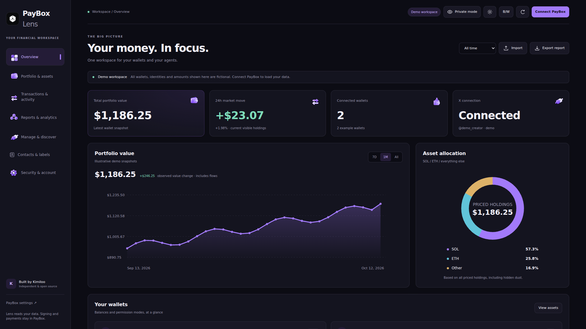
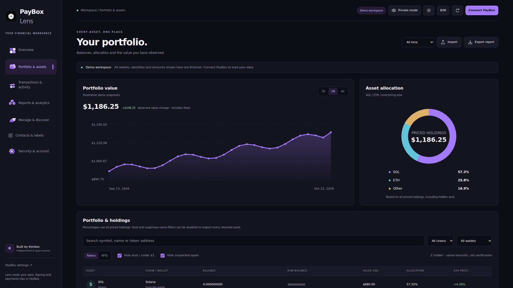
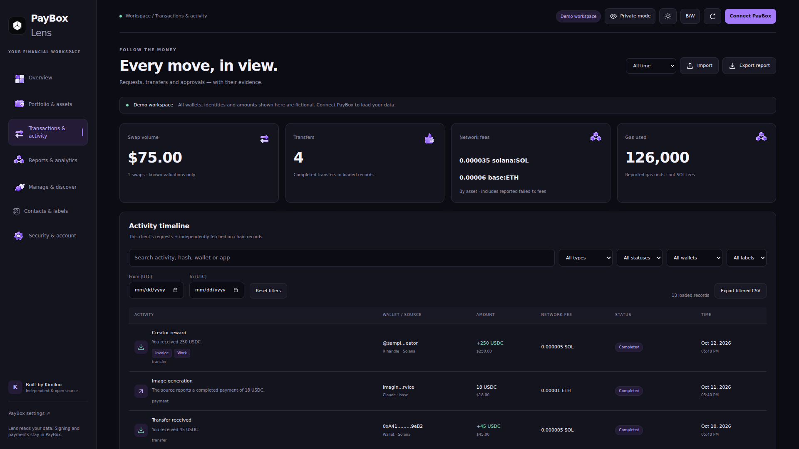
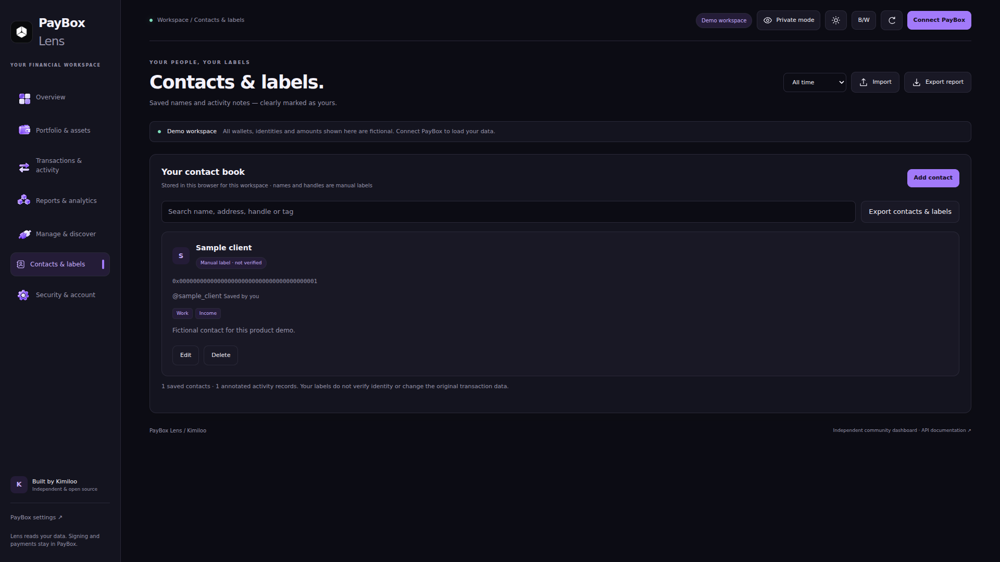
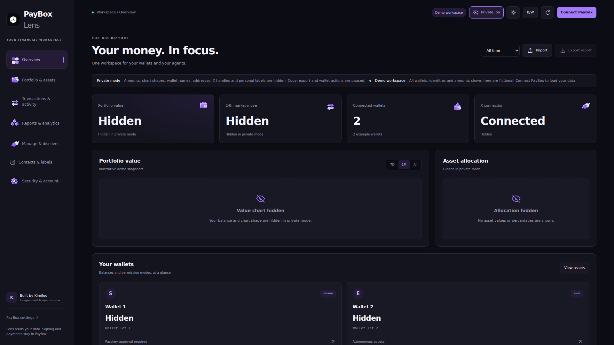
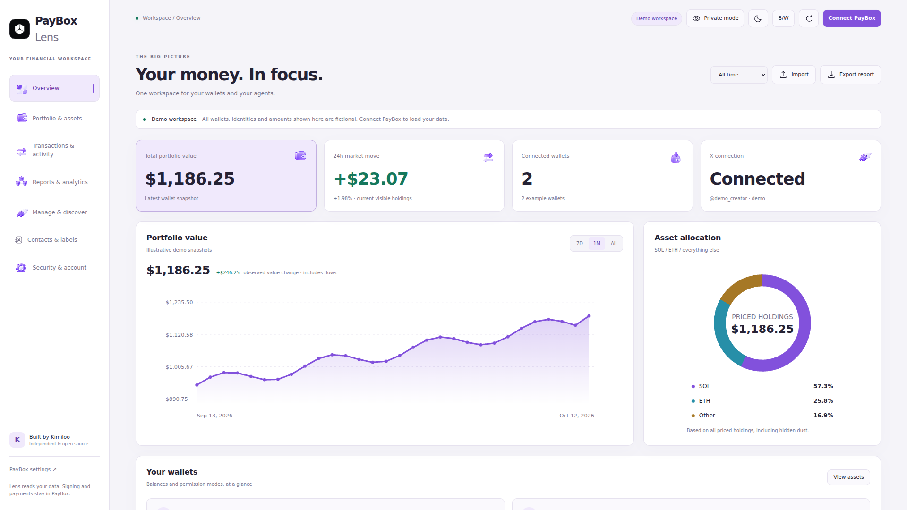

# PayBox Lens

An English financial dashboard for PayBox, built by **Kimiloo**. Independent
community project; not an official PayBox product. MIT-licensed source.

[Report a bug](https://github.com/kimilooo/paybox-lens/issues/new?template=bug_report.yml) ·
[Contribute a pull request](CONTRIBUTING.md) ·
[PayBox website](https://paybox.sh/) · [PayBox documentation](https://docs.paybox.sh/)

> **Your local data stays yours.** When you install and run this app on your own
> device, I, Kimiloo, do not receive your financial data, tokens, contacts or private
> notes. There is no maintainer-controlled data collector or remote database.
> PayBox and public chain providers receive requests needed for their services.
> A remote hosting operator can inspect traffic through their server; this privacy
> statement applies to running your own local copy. See [PRIVACY.md](docs/PRIVACY.md).

## Quick start

Install Node.js **24+** and Git, then:

```sh
git clone https://github.com/kimilooo/paybox-lens.git
cd paybox-lens
npm ci --ignore-scripts
npm test
npm start
```

Open **http://localhost:3000/**. No Docker, external database account or production
npm dependencies. SQLite is built into Node. Dependencies installed by npm are
for automated tests only. First launch shows clearly labeled fictional demo data.

Full walkthrough: [local setup](docs/LOCAL_SETUP.md).

## Screenshots

Actual dashboard captures using **fictional demo data**, not a real account.
These show the workspace UI; the remembered local sign-in flow is described below.

### Overview — purple dark mode



| Portfolio & assets | Transactions & activity |
| --- | --- |
|  |  |

| Contacts & labels | Private mode |
| --- | --- |
|  |  |

### Light mode



## Sign in once, restore the local connection

Select **Connect PayBox → Keep me signed in on this device**, then approve the
requested grants in PayBox. Access and rotating refresh tokens stay in your local
server; remembered tokens are encrypted in local SQLite and never returned to
browser JavaScript. Reloading and reopening the app restores the connection.
PayBox expiry/revocation or an interrupted token rotation can require sign-in again.
This is reusable authorization, **not permanent login**. Without remember, tokens
stay only in the local server's memory. Disconnect removes that saved connection.

Local records are stored in `data/lens.sqlite`, encrypted with a separate local
`data/encryption.key`. Both stay on your device and are excluded from releases.
Contacts, labels, public chain history, USD snapshots and preferences have a local
DB backup. Browser localStorage also keeps these records and is not encrypted.
Back up both DB/key files privately with the server stopped. No seed phrase,
private key, raw card secret or password is requested by Lens.

## Seven pages

1. **Overview** — total wallet USD value, 24h market-move estimate where prices exist, wallet count, X status availability, SOL/ETH/Other allocation, wallet cards and credential approval modes.
2. **Portfolio & assets** — symbols, chain, raw and display balances, USD values, allocation and fractional 24h price changes. Search and wallet/chain filters. Dust under $1 and suspicious token names are hidden by default and can be shown. An NFT tab displays NFT records only if the provider supplies them.
3. **Transactions & activity** — this client's request history plus public on-chain records. Combined type, status, wallet and UTC-date filters; 50-row UI pages; exact hashes/explorer links; `get_request` refresh for this client's request details. Reported fees, gas units, error reasons and swaps remain distinct.
4. **Reports & analytics** — UTC daily/weekly/monthly groups, incoming/outgoing flows, observed value change, agent activity and portfolio observations. Genuine PDF, XLSX and CSV downloads. Excel includes Summary, Activity, Holdings and Tax worksheet sheets. Missing cost basis or proceeds leave gains unknown.
5. **Manage & discover** — receive-address display, signed MoonPay checkout links, enabled-plugin search, trending-token discovery, local USD alert threshold, and official PayBox handoffs for swap/send/X-recipient resolution. Actions requiring signing are completed in PayBox.
6. **Contacts & labels** — create, edit, search and delete locally saved contacts; optional unverified X handles, contact tags and notes. Names match EVM addresses case-insensitively and Solana addresses exactly. Annotate transactions with persistent tags/notes and filter or search them.
7. **Security & account** — granted credentials and approval modes, connection-management links, X/settings links, this tab's read log, approval requests, snapshot export and clearing.

## Coverage and actions

- PayBox request history is scoped to this OAuth client, not all agents/clients.
- Public chain scans cover Solana, Ethereum, Base, Optimism, Arbitrum and Polygon
  when their providers are reachable. **Complete history since wallet creation
  is not guaranteed**; indexing/access/closed-account gaps are displayed.
- Sender X identities and plugin attribution are shown only when the source
  supplies evidence. Manual contacts and imported labels are not verified identities.
- No transaction is signed/executed by Lens. Transfers, swaps and permission
  changes open official PayBox flows. Buy links open MoonPay; opening a link does
  not complete a purchase. Secret-reveal and execution tools are blocked.
- Unknown historical USD values/cost basis stay unknown. Swaps are not classified
  as expenses. Reported duplicate hashes are deduplicated for totals. Tax exports
  are worksheets, not completed tax returns. Observed portfolio changes include
  deposits/withdrawals and are not realized profit.
- Private mode hides display values/identifiers/chart shapes and blocks copy/export.
  It does not encrypt browser data or hide other applications.

## Security checks

[CI](https://github.com/kimilooo/paybox-lens/actions/workflows/ci.yml) ·
[CodeQL](https://github.com/kimilooo/paybox-lens/actions/workflows/codeql.yml) ·
[Security policy](SECURITY.md)

The workflows run tests, npm advisory checks, publication checks, CodeQL
JavaScript analysis and PR dependency review; Dependabot maintains dependencies
and Actions. Review results for the exact commit you download. There is no GitHub
“firewall passed” or malware-free certificate, and passing scans is not a proof
that every vulnerability or malicious behavior is absent.

```sh
npm run build
npm run check
npm run security
npm run release:prepare
```

The last command creates an allowlisted `public-release/` source tree plus
SHA256SUMS. It excludes hosting identity, build output, Git history, private data,
local DB/key, real environment settings and account exports. Do not publish the
original development checkout wholesale. Public GitHub secret scanning and push
protection complement the included checks.

## Architecture and deployment

[Architecture](docs/ARCHITECTURE.md) · [Privacy](docs/PRIVACY.md) · [Security](SECURITY.md)

The local Node adapter adds session-bound PKCE, encrypted SQLite and remembered
OAuth to the same static frontend and constrained Worker bridge. The reusable
Worker build remains stateless and does not request refresh tokens in hosted mode.
`npm run start:ephemeral` runs that older memory-only adapter locally. Static
GitHub Pages cannot run the bridge or the local database/session backend.

Optional server-only providers go in `.env`; see `.env.example`. Public reads
are attempted without provider keys, but paid access may be required by some
networks/providers. Keys do not guarantee complete archival coverage.

Tests use fictional fixtures and mocked OAuth/provider responses. Fresh local
HTTP/SQLite checks verify installation and auth behavior; actual user PayBox
consent, funds movement and long-term provider availability are not certified.

## Bugs and pull requests welcome

Found a bug or have an improvement? Please [open a bug report](https://github.com/kimilooo/paybox-lens/issues/new?template=bug_report.yml)
or [submit a pull request](https://github.com/kimilooo/paybox-lens/compare).
Include clear reproduction steps, expected behavior, your app/Node/browser versions
and a redacted screenshot when useful. Reproduce with demo data where possible.
Do not post tokens, database/key files, private notes or real account screenshots.
Report security vulnerabilities using the route in [SECURITY.md](SECURITY.md).

Start with [CONTRIBUTING.md](CONTRIBUTING.md) for the local workflow, project layout
and checks to run before a pull request. Small fixes, documentation improvements,
accessibility feedback and meaningful regression tests are welcome.

## Official PayBox resources

PayBox Lens is independent. These links point to PayBox's own services and docs.

| Resource | Link |
| --- | --- |
| Website | [paybox.sh](https://paybox.sh/) |
| PayBox app | [app.paybox.sh](https://app.paybox.sh/) |
| Account settings & X connection | [PayBox settings](https://app.paybox.sh/settings) |
| Documentation home | [docs.paybox.sh](https://docs.paybox.sh/) |
| Getting started | [Initial setup](https://docs.paybox.sh/getting-started) |
| Credentials & agents | [Core model and grants](https://docs.paybox.sh/concepts/model) |
| Approvals & passkeys | [Approval modes](https://docs.paybox.sh/concepts/approvals) |
| Request lifecycle | [Requests and their states](https://docs.paybox.sh/concepts/requests) |
| MCP connector | [Connect an agent](https://docs.paybox.sh/connect/mcp) |
| OAuth 2.1 | [App authorization with PKCE](https://docs.paybox.sh/connect/oauth) |
| MCP tools | [Tool reference](https://docs.paybox.sh/reference/mcp-tools) |
| API & endpoints | [API reference](https://docs.paybox.sh/api-reference) |
| SDK & CLI | [Developer tooling](https://docs.paybox.sh/sdk-cli) |

## Attribution

Code: MIT (see LICENSE). Generated purple icon artwork is included. The supplied
PayBox brand image is used for identification; PayBox trademarks remain with
its owner and do not imply endorsement. [Powered by Routescan.io APIs](https://routescan.io)
for supported keyless fallback requests; provider limits apply.
